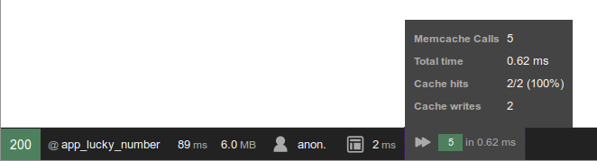

[](https://github.com/mevdschee/TqdMemcacheBundle/actions/workflows/tests.yml)
[](http://isitmaintained.com/project/mevdschee/TqdMemcacheBundle "Average time to resolve an issue")
[](http://isitmaintained.com/project/mevdschee/TqdMemcacheBundle "Percentage of issues still open")
[](https://packagist.org/packages/mevdschee/memcache-bundle)

TqdMemcacheBundle
=================



If you want to optimize your web application for high load and/or low load times Memcache is an indispensable tool.
It will manage your session data without doing disk I/O on web or database servers. You can also run it as a
central object storage for your website. In this role it is used for caching database queries using the Doctrine 
caching support or expensive API calls by implementing the caching using Memcache "get" and "set" commands.

This Symfony bundle will provide Memcache integration into Symfony and Doctrine for session storage and caching. 
It has full Web Debug Toolbar integration that allows you to analyze and debug the cache behavior and performance.

[Read the TQdev.com blog about TqdMemcacheBundle](http://tqdev.com/2016-symfony-memcache-bundle-v3-released)

### Requirements

- PHP 8.1 or higher
- Symfony 6.4 or 7.x
- php-memcache 8.0 or higher
- memcached 1.4 or higher

Version 3.x of this bundle supports PHP 5.3 to 7.x with Symfony 2 and 3.

### Installation

To install TqdMemcacheBundle with Composer just run the following command:

    php composer.phar require tqdev/memcache-bundle

If you do not use Symfony Flex, add the bundle to the 'config/bundles.php' file:

    return [
        ...
        Tqd\MemcacheBundle\TqdMemcacheBundle::class => ['all' => true],
    ];

Configure the bundle by adding the following to 'config/packages/tqd_memcache.yaml':

```yml
tqd_memcache:
    session:
        pool: default
    pools:
        default:
            servers:
              - { host: localhost, tcp_port: 11211 }
```

Install the following dependencies (on Ubuntu based systems using 'apt-get'):

    apt-get install memcached php-memcache

Do not forget to restart you web server after adding the Memcache module. Now the Memcache
information should show up with a little double arrow (fast-forward) icon in your debug toolbar.

### Usage

Every pool is available as a service named 'memcache.' followed by the pool name. You can inject it in
your controller or service:

    use Symfony\Component\DependencyInjection\Attribute\Autowire;
    use Tqd\MemcacheBundle\Cache\AntiDogPileMemcache;

    public function index(#[Autowire(service: 'memcache.default')] AntiDogPileMemcache $memcache)
    {
        $memcache->set('someKey', 'someValue', 0, $timeToLive);
        $memcache->get('someKey');
    }

The above example shows how to store value 'someValue' under key 'someKey' for a maximum of $timeToLive
seconds (the 0 parameter are the 'flags'). In the second line the value is retrieved from Memcache.
If the key can not be found or the specified number of seconds have passed the 'get' function returns
the value 'false'.

### Configuration

Below you can see an example configuration for this bundle.

```yml
tqd_memcache:
    pools:
        default:
            servers:
                - { host: 10.0.0.1, tcp_port: 11211, weight: 15 }
                - { host: 10.0.0.2, tcp_port: 11211, weight: 30 }
            options:
		        allow_failover: true
		        max_failover_attempts: 20
		        default_port: 11211
		        chunk_size: 32768
		        protocol: ascii
		        hash_strategy: consistent
		        hash_function: crc32
		        redundancy: true
		        session_redundancy: 2
		        compress_threshold: 20000
		        lock_timeout: 15
        sessions:
            servers:
                - { host: localhost, tcp_port: 11212 }
```

### Session Support ###

This bundle also provides support for storing session data on Memcache servers. To enable session support
you will have to enable it through the ```session``` key (```auto_load``` is true by default). Note that the only
required subkey of the session support is ```pool``` (a valid pool). You can also specify a key ```prefix```
and a ```ttl```.

```yml
tqd_memcache:
    session:
        pool: sessions
        auto_load: true
        prefix: "session_"
        ttl: 7200
        locking: true
        spin_lock_wait: 150000
    # pools
```

Note that the session locking is enabled by default and the default spin lock is set to poll every 150 milliseconds (150000 microseconds).

### Doctrine Support ###

This bundle also provides support for Doctrine caching on Memcache servers. It requires the
'doctrine/cache' package (```composer require doctrine/cache```) and provides PSR-6 cache pools
as used by Doctrine ORM 2.x/3.x and DoctrineBundle 2.x/3.x. To enable Doctrine caching
you will have to enable it through the ```doctrine``` key. Note that you can specify all three kinds of
Doctrine caching: 'metadata', 'result' and 'query'. The required keys within those subkeys are both 
```pool``` (a valid pool) and ```entity_manager``` (normally: default). You can also specify a ```prefix```.

```yml
tqd_memcache:
    doctrine:
        metadata_cache:
            pool: default
            entity_manager: default          # the name of your entity_manager connection
            document_manager: default        # the name of your document_manager connection
        result_cache:
            pool: default
            entity_manager: [default, read]  # you may specify multiple entity_managers
            prefix: "result_"                # you may specify a prefix for the entries
        query_cache:
            pool: default
            entity_manager: default
    # pools
```

### Firewall Support ###

This bundle also provides support a firewall that limits the number of concurrent requests per IP address.
It maintains a counter of running requests per IP address and delays (throttles) the requests if nessecary. 
To enable firewall support you will have to enable it through the ```firewall``` key. Note that the only
required subkey of the firewall support is ```pool``` (a valid pool). You can also specify a key ```prefix```
and a ```concurrency``` (default is 10). If you use one or more reverse proxies, then specify them in the
```reverse_proxies``` key. The client IP address is then read from the 'X-Forwarded-For' header (or the
header specified in the ```x_forwarded_for``` key) when the request comes from one of those proxies.

```yml
tqd_memcache:
    firewall:
        pool: firewall
        prefix: "firewall_"
        concurrency: 10
        reverse_proxies: [10.0.0.1]
    # pools
```

### ADP: Anti Dog Pile

Let us examine a high traffic website case and see how Memcache behaves:

Your cache is stored for 90 minutes. It takes about 3 second to calculate the cache value and 1 ms second to read the cached value from the cache. You have about 5000 requests per second and let's assume that the value is cached. You get 5000 requests per second taking about 5000 ms to read the values from cache. You might think that that is not possible since 5000 > 1000, but that depends on the number of worker processes on your web server. Let's say it is about 100 workers (under high load) with 75 threads each. Your web requests take about 20 ms each. Whenever the cache invalidates (after 90 minutes), during 3 seconds, there will be 15000 requests getting a cache miss. All the threads getting a miss will start to calculate the cache value (because they don't know the other threads are doing the same). This means that during (almost) 3 seconds the server wont answer a single request, but the requests keep coming in. Since each worker has 75 threads (holding 100 x 75 connections), the amount of workers has to go up to be able to process them.

The heavy forking will cause extra CPU usage and the each worker will use extra RAM. This unexpected increase in RAM and CPU is called the 'dog pile' effect or 'stampeding herd' or 'thundering herd' and is very unwelcome during peak hours on a web service.

There is a solution: we serve the old cache entries while calculating the new value and by using an atomic read and write operation we can make sure only one thread will receive a cache miss when the content is invalidated. The algorithm is implemented in AntiDogPileMemcache class in TqdMemcacheBundle. It provides the getAdp(), setAdp() and deleteAdp() functions that can be used as replacements for the normal get, set and delete.

Please note:

- ADP might not be needed if you have low amount of hits or when calculating the new value goes relatively fast.
- ADP might not be needed if you can break up the big calculation into smaller, maybe even with different timeouts for each part.
- ADP might get you older data than the invalidation that is specified. Especially when a thread/worker gets "false" for "get" request, but fails to "set" the new calculated value afterwards.
- ADP's "getAdp", "setAdp" and "deleteAdp" are more expensive than the normal "get", "set" and "delete", slowing down all cache hits.
- ADP does not guarantee that the dog pile will not occur. Restarting Memcache, flushing data or not enough RAM will also get keys evicted and you will run into the problem anyway.

### Known issues

The session write that invokes a memcache set operation is executed after the page has been rendered.
The collect call of the memcache data collector is executed before the rendering of the page is complete
and therefor also before the session write is executed. This causes the session writes not to show up in
the Web Debug Toolbar.

### Credits

Doctrine support is based on the implementation in SncRedisBundle:

https://github.com/snc/SncRedisBundle by Henrik Westphal

- DependencyInjection/TqdMemcacheExtension.php
- DependencyInjection/Configuration.php
- DependencyInjection/Compiler/EnableSessionSupport.php

Are based on implementation in:

https://github.com/Emagister/MemcachedBundle by Christian Soronellas

- Command/StatisticsCommand.php

Is based on an implementation in:

https://github.com/beryllium/CacheBundle by Kevin Boyd

### License

This bundle is under the MIT license.
